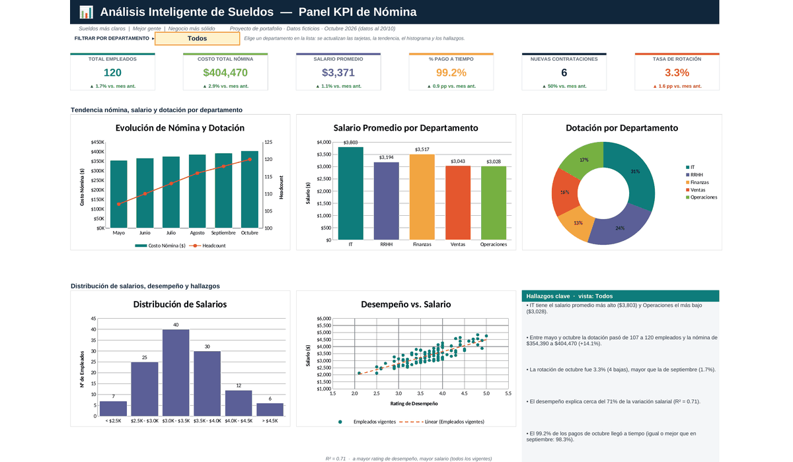
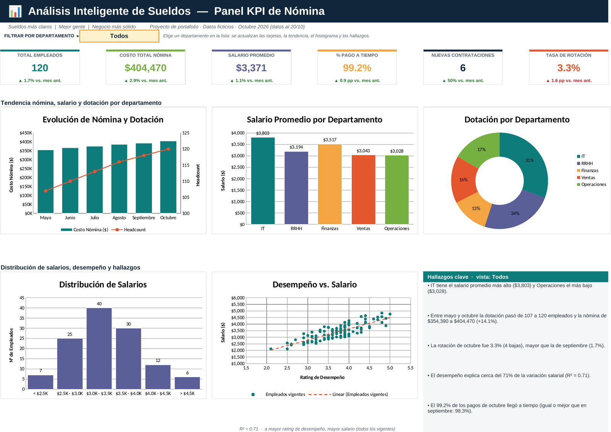
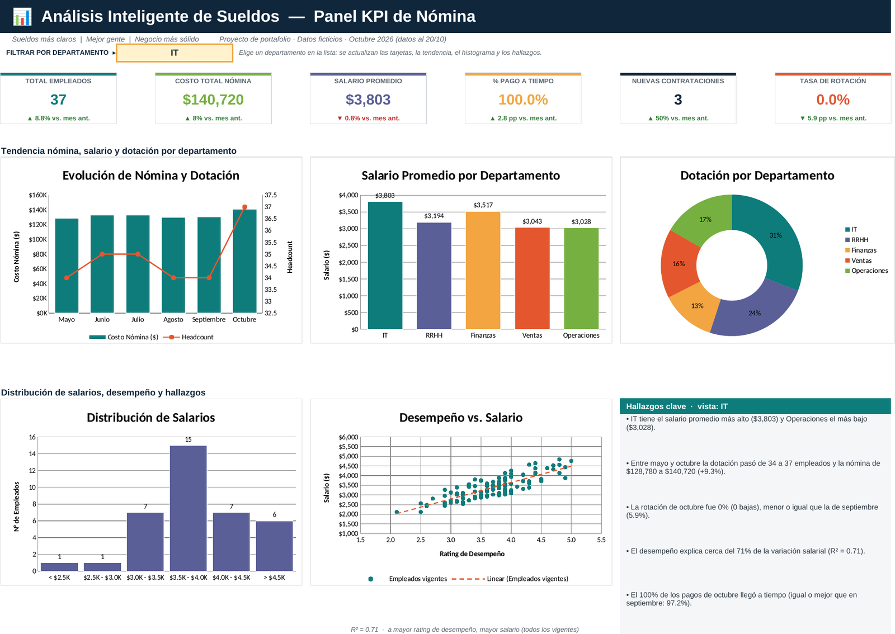
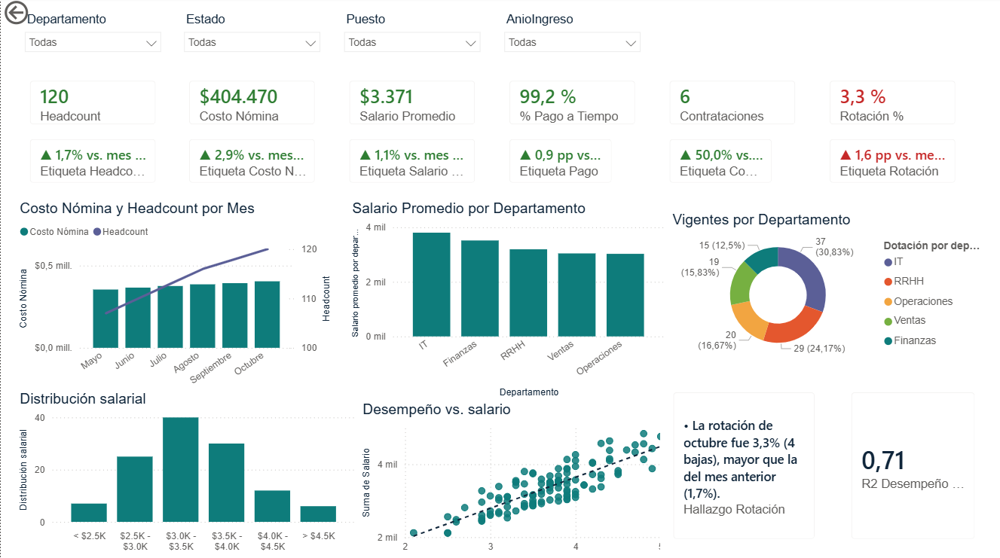
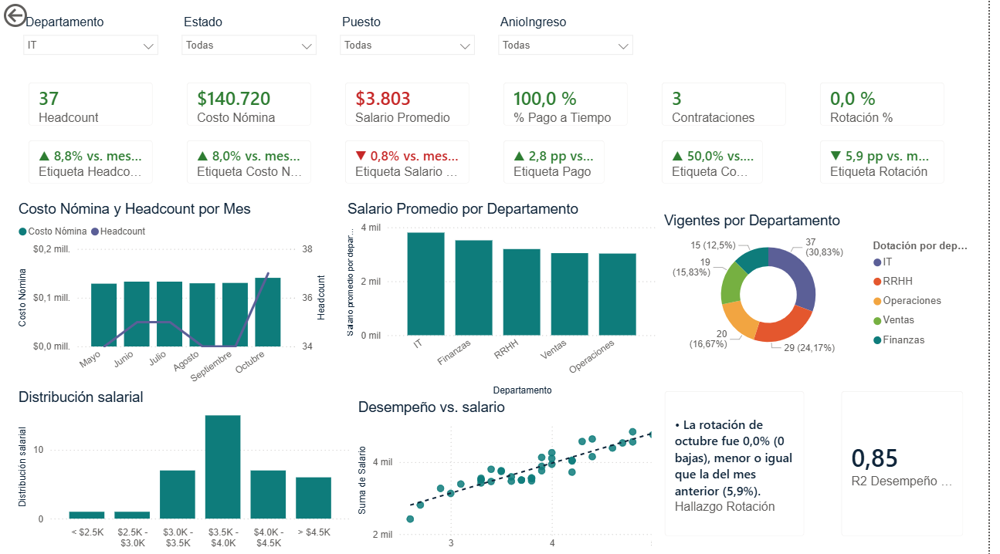
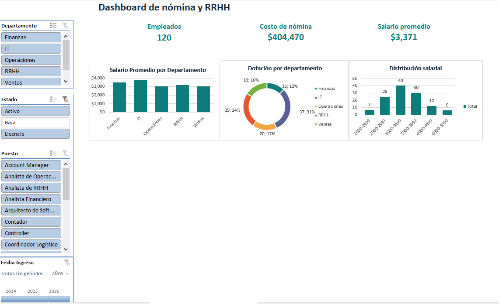
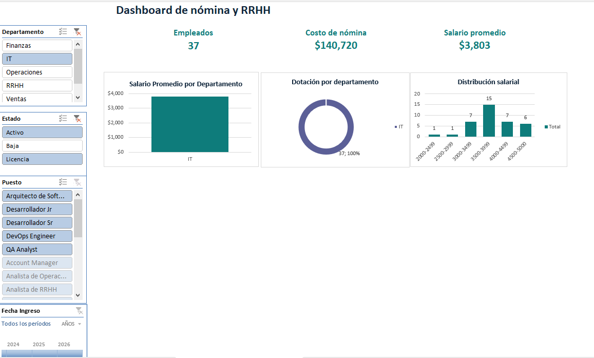

# Dashboard de Nómina y RRHH en Excel y Power BI


Panel de KPIs de sueldos y personal, hecho primero solo con fórmulas de Excel (tarjetas con variación mensual, cinco gráficos y un selector de departamento que recalcula todo) y después rehecho en Power BI con el mismo modelo de datos y medidas DAX. Lo armé para practicar análisis administrativo con datos propios y mostrar cómo paso de una tabla de empleados a un tablero que se puede leer en un minuto.



## 📸 Capturas

**Versión Excel**

| Vista general | Filtrado por departamento (IT) |
|---|---|
|  |  |

**Versión Power BI** (mismos datos y mismos KPIs)

| Vista general | Filtrado por departamento (IT) |
|---|---|
|  |  |

**Versión Excel con tabla dinámica y segmentaciones nativas**

| Vista general | Filtrado por departamento (IT) |
|---|---|
|  |  |

## ✅ Qué hace

1. **Seis KPIs** con variación contra el mes anterior: total de empleados, costo de nómina, salario promedio, % de pagos a tiempo, nuevas contrataciones y tasa de rotación.
2. **Selector de departamento** (lista desplegable en la celda amarilla): filtra las tarjetas, la tendencia, el histograma y el panel de hallazgos.
3. **Cinco gráficos**: nómina y dotación por mes (barras con línea en eje secundario), salario promedio y dotación por departamento, distribución salarial y dispersión desempeño vs. salario.
4. **Hallazgos automáticos**: cinco frases que se recalculan solas según el departamento elegido.
5. **Histórico calculado, no escrito a mano**: mayo a octubre de 2026 sale de las hojas de datos con `COUNTIFS` y `SUMIFS` según fecha de ingreso y de baja.

## 🔎 Caso de análisis

Con la vista **Todos** (datos al 20/10/2026):

| Indicador | Octubre | Septiembre |
|---|---|---|
| Empleados | 120 | 118 |
| Costo de nómina | $404,470 | $393,260 |
| Salario promedio | $3,371 | $3,333 |
| Pagos a tiempo | 99.2% | 98.3% |
| Contrataciones | 6 | 4 |
| Rotación | 3.3% (4 bajas) | 1.7% (2 bajas) |

Lo que cuenta el panel:

- **IT** tiene el salario promedio más alto ($3,803) y **Operaciones** el más bajo ($3,028).
- Entre mayo y octubre la dotación pasó de 107 a 120 empleados y la nómina de $354,390 a $404,470 (+14.1%).
- La rotación se duplicó en octubre. Es la señal a mirar: se contrató más, pero también se fue más gente.
- El desempeño explica cerca del 71% de la variación salarial (R² = 0.71).

Un ejemplo de las fórmulas, el headcount de un mes (ingresados a fin de mes menos los que ya tienen fecha de baja):

```excel
=COUNTIFS(Datos_Departamento,Crit_Depto,Datos_Ingreso,"<="&C7)
-COUNTIFS(Datos_Departamento,Crit_Depto,Datos_Baja,"<="&C7)
```

`Crit_Depto` vale `*` cuando el selector dice "Todos" y el nombre del departamento en los demás casos, así una sola fórmula sirve para ambas vistas.

## 🔀 El mismo modelo en otras herramientas

Los datos están separados en tablas (empleados, pagos y meses), así que el mismo análisis se puede replicar en otras herramientas:

- **Power BI (terminado):** la carpeta [`powerbi/`](powerbi/guia-powerbi.md) trae el informe `.pbix`, las tablas en CSV, las medidas DAX equivalentes a las fórmulas del Excel, un tema con la misma paleta y una guía para armarlo. Cuatro segmentaciones reemplazan al selector, y la dona y las barras por departamento ignoran el filtro de departamento para mostrar siempre los cinco. Comprobé las tarjetas contra los valores del Excel, con todos los departamentos y con IT (por ejemplo, 120 empleados y $404,470 de nómina en octubre).
- **Excel con tabla dinámica y segmentaciones nativas (terminado):** el libro [`Dashboard_RRHH_Nomina_Segmentaciones.xlsx`](Dashboard_RRHH_Nomina_Segmentaciones.xlsx) trae cuatro tablas dinámicas, tres gráficos dinámicos y filtros de Departamento, Estado, Puesto y año de ingreso (segmentaciones y escala de tiempo) que mueven todo a la vez. [Esta guía](docs/guia-tabla-dinamica-segmentaciones.md) explica cómo se armó. A diferencia de Power BI, aquí un filtro de departamento también reduce los gráficos que comparan departamentos, porque las segmentaciones nativas filtran todas las tablas conectadas.

## 🧠 Qué practica este proyecto

- **Excel:** `COUNTIFS`, `SUMIFS`, `AVERAGEIFS`, `RSQ`, `INDEX/MATCH`, `IFERROR`, rangos con nombre, validación de datos, formato condicional, tablas y gráficos combinados.
- **Tablas dinámicas:** campos de valor, agrupación de rangos salariales, gráficos dinámicos, segmentaciones y escala de tiempo conectadas a varias tablas, y tarjetas con `IMPORTARDATOSDINAMICOS` (`GETPIVOTDATA`).
- **Power BI y DAX:** modelo con tablas separadas y medidas que calculan el headcount a fin de mes, la rotación y la variación contra el mes anterior.
- **Modelado de datos:** separar datos, pagos, cálculos y presentación en hojas distintas.
- **Análisis:** definir bien cada KPI (qué cuenta como empleado, cómo se calcula la rotación) antes de graficarlo.
- **Presentación:** jerarquía visual, colores con significado y texto que explica lo que se ve.

## ▶️ Cómo usarlo

1. Descarga [`Dashboard_RRHH_Nomina.xlsx`](Dashboard_RRHH_Nomina.xlsx) y ábrelo en Excel (no usa macros).
2. En la hoja **Dashboard**, elige un departamento en la celda amarilla.
3. Para ver cómo se calcula cada cifra, revisa **Formulas_Clave**.
4. Para la versión con segmentaciones, abre [`Dashboard_RRHH_Nomina_Segmentaciones.xlsx`](Dashboard_RRHH_Nomina_Segmentaciones.xlsx) y ve a la hoja **Dashboard_Segmentaciones**. Los filtros están a la izquierda; las tablas que los alimentan están en **Tablas_Pivot**.

## 🗂️ Cómo está organizado

| Hoja | Qué contiene |
|---|---|
| `Dashboard` | Vista final: selector, tarjetas, gráficos y hallazgos |
| `Datos` | 132 registros: 120 vigentes (114 activos y 6 en licencia) y 12 bajas |
| `Pagos` | Estado de pago (a tiempo o tardío) por empleado y mes |
| `Nomina_Mensual` | Histórico mensual calculado con fórmulas |
| `Calculos` | KPIs, tablas por departamento, rangos salariales y R² |
| `Formulas_Clave` | Documentación de cada fórmula |

Además del libro, el repositorio tiene `Dashboard_RRHH_Nomina_Segmentaciones.xlsx` (mismas hojas de datos, más `Tablas_Pivot` con las tablas dinámicas y `Dashboard_Segmentaciones` con los filtros, tarjetas y gráficos), `powerbi/` (informe `.pbix`, CSV, medidas DAX, tema y guía) y `docs/` (guía de segmentaciones y capturas).

Decisiones de diseño: "empleado" incluye personal en licencia; la rotación es bajas del mes sobre headcount a fin de mes; los porcentajes se comparan en puntos porcentuales; en rotación, una subida se marca en rojo.

## 🐛 Errores que encontré probando

- **Rotación en verde.** Las flechas pintaban toda subida de verde, pero si la rotación sube es una mala noticia. Invertí los colores solo en esa tarjeta.
- **Un R² de 0.05.** Mis primeros datos eran casi aleatorios y el gráfico de desempeño vs. salario no mostraba nada. Rehice los datos con una relación real entre rating y salario.
- **Histórico escrito a mano.** Al inicio los meses anteriores eran números fijos. Los reemplacé por fórmulas para que todo salga de los datos.
- **Meses duplicados en un gráfico.** El eje del gráfico combinado aparecía dos veces al abrirlo en Excel. Lo detecté en una captura real y lo corregí.
- **Rating leído como 45 en Power BI.** Con la configuración regional en español, el punto decimal de `4.5` se tomó como separador de miles. Lo resolví cambiando el tipo con la configuración regional Inglés (EE. UU.) en Power Query.
- **Un error de DAX en el mes anterior.** `MAX()` no se puede usar dentro del filtro de `CALCULATE`; guardé la fecha en una variable antes.
- **Rotación en blanco ("--").** En un departamento sin bajas, `COUNTROWS` devolvía vacío en lugar de 0, y la tarjeta no mostraba nada. Le sumé 0 a la medida de bajas.
- **Salario promedio con 6 decimales.** En las tarjetas de la versión con segmentaciones apareció `3370.583333`; era solo el formato de la celda. Le puse `$#,##0`.
- **Línea de dotación pegada abajo.** En el gráfico combinado, 37 empleados no se veían en la escala de la nómina. La línea necesitó su eje secundario.

También validé las cifras del libro contra un cálculo independiente en Python, con "Todos" y con departamentos filtrados, y usé esos valores para comprobar el informe de Power BI.

## 🔜 Próximos pasos

- [ ] Probar con datos anonimizados de un caso real.

---

Hecho por [Leidy Lozada](https://github.com/Ladydlozada). Todos los datos son ficticios.
